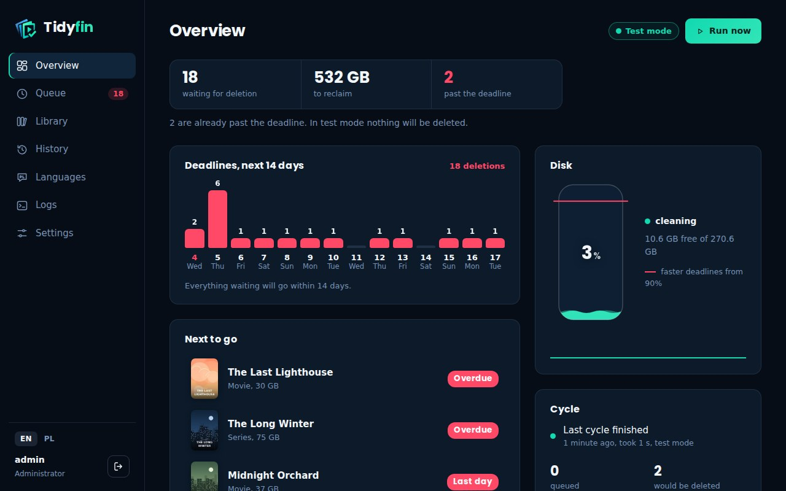
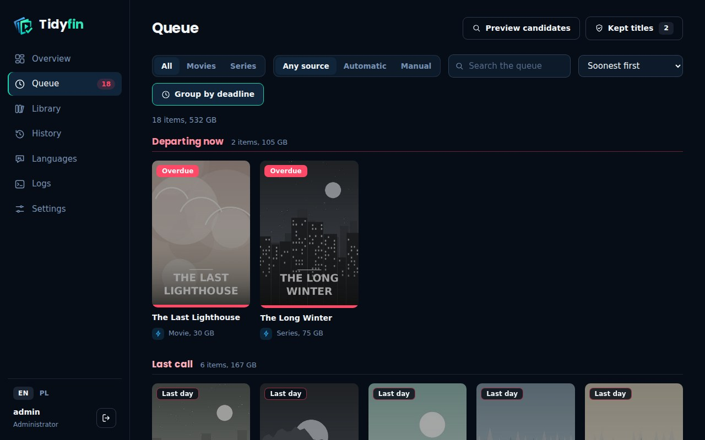
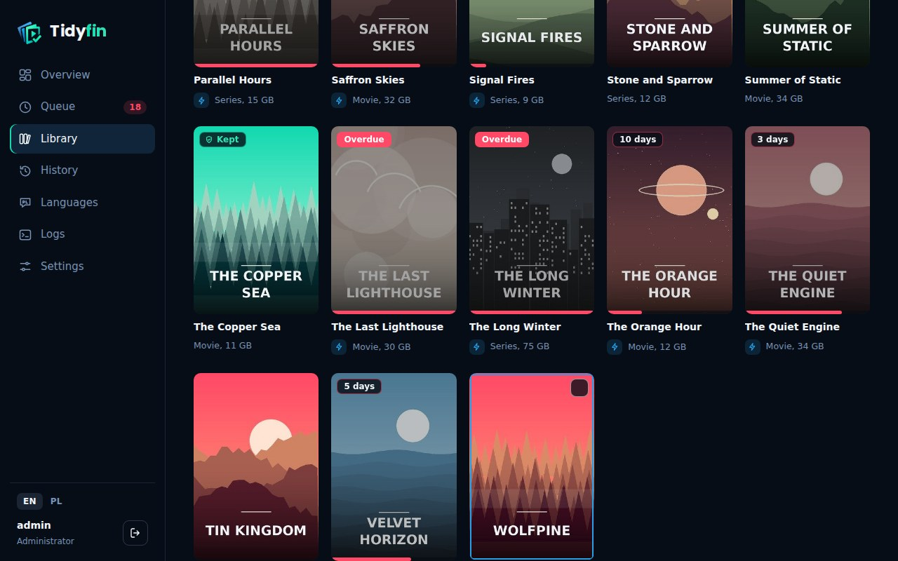

<h1 align="center">
  <picture>
    <source media="(prefers-color-scheme: dark)" srcset="docs/logo-dark.png">
    
  </picture>
</h1>

<p align="center">Keeps your Jellyfin library tidy through Radarr and Sonarr.</p>

<p align="center">
  <a href="https://github.com/BeYor/Tidyfin/actions/workflows/ci.yml"></a>
  <a href="https://github.com/BeYor/Tidyfin/releases"></a>
  <a href="LICENSE"></a>
</p>



Tidyfin is a self-hosted app that deletes movies and series nobody watches, after a grace period you control. It shows what is about to disappear, on the posters in Jellyfin and in a dashboard, lets you keep what you want, and marks titles that have audio or subtitles in the languages you care about.

Tidyfin is **source-available**, not open source: you can use, read and change it freely for personal and other noncommercial purposes, and commercial use needs permission. See [License](#license).

## How it works

A movie or series is queued for deletion when **all** of these hold:

- the disk is at least as full as the *start cleaning* threshold (default 40%, 0 means always),
- it has no protection tag in Radarr/Sonarr,
- its file is old enough (movies: age of the file; series: age of the oldest episode file),
- nobody has watched it for the configured number of days (the latest play across all Jellyfin users counts),
- nobody else is protecting it: no star from another user and no place in someone's *Continue watching* for a number of days you set.

The deadline is midnight UTC, *grace period* days after the title was queued. Until then anyone with access to the dashboard can keep or postpone it. Deletion goes through Radarr/Sonarr.



## Features

**Cleanup**
- Separate thresholds for movies and series.
- Manual deletion: star a title in Jellyfin, or choose *Delete in...* in the dashboard (a number of days or a calendar date).
- Disk-aware grace period: when the disk fills up, the grace period can shrink, optionally also for titles already queued.
- *Test the values* shows what would qualify with the thresholds on screen, next to what qualifies now, before you save them.

**Protection**
- *Keep* adds a protection tag in Radarr/Sonarr, and tagged titles are never deleted. *Keep until...* protects a title only until a day you pick.
- Stars from other users and *Continue watching* protect a title for a limited time, so a forgotten star cannot pin it forever.

**Posters and collections**
- A countdown and language badges are drawn on the Jellyfin posters. Text, corner, colours, size and style (frosted glass, tinted glass, gradient, neon and more) of every badge are configurable, with a live preview on a poster from your library.
- Original posters are backed up and restored when a badge goes away.
- "Leaving soon" collections for movies and series.

**Languages**
- Presets for 9 languages plus custom profiles. A profile describes how to recognise audio, dub, voice-over and subtitles.
- Tags can be written to Jellyfin from the dashboard, which also shows what was detected for a title.

**Dashboard**
- Queue, library browser, history, logs, settings, and a summary of what cleanup did over 7, 30 or 90 days.
- English and Polish. Sign in with a Jellyfin administrator account.
- Notifications through Discord, ntfy, Telegram or a generic JSON webhook, including a message when Radarr, Sonarr or Jellyfin has not answered for several cycles.



## Safety

- A fresh install starts in **test mode**: nothing is deleted until you turn it off.
- If Radarr, Sonarr or Jellyfin does not answer, Tidyfin does not guess. It never empties a queue and never deletes anything it could not fully evaluate in that cycle.
- A title removed from Radarr or Sonarr by hand leaves the queue in the next cycle.
- Deletion goes through Radarr/Sonarr with `deleteFiles=true`. Tidyfin itself does not need write access to your media folders, so you can mount them read-only.
- The Jellyfin password is used once to sign in and is never stored.

## Requirements

- Docker on any host. The image is built for amd64 and arm64.
- Jellyfin 10.9 or newer, and Radarr and/or Sonarr (the v3 API, which v4 and v5 also serve).

## Install

```yaml
services:
  tidyfin:
    image: ghcr.io/beyor/tidyfin:latest
    container_name: tidyfin
    restart: unless-stopped
    ports:
      - "8484:8484"
    environment:
      TZ: Europe/Warsaw
    volumes:
      - ./data:/data              # database, poster backups
      - /path/to/media:/media:ro  # only used to measure disk usage and to scan files for languages
```

Then open `http://<host>:8484`. The repository contains a ready `docker-compose.yml` with the metadata ZimaOS and CasaOS need to show Tidyfin as an app.

### First run

1. Sign in with a Jellyfin **administrator** account and enter the Jellyfin address as the container sees it. Tidyfin creates its own API key.
2. Add Radarr and/or Sonarr (address and API key, then *Test*).
3. Pick the languages you want to mark.
4. Look at the queue and at *Preview candidates*, then switch test mode off in *Settings*.

## Configuration

Almost everything is set in the dashboard. Environment variables:

| Variable | Default | Meaning |
|---|---|---|
| `TIDYFIN_DATA_DIR` | `/data` | database and poster backups |
| `TIDYFIN_PORT` / `TIDYFIN_HOST` | `8484` / `0.0.0.0` | listen address |
| `TIDYFIN_LOG_LEVEL` | `INFO` | log verbosity |
| `TIDYFIN_STATIC_DIR` | `/app/static` | dashboard files |

API keys and notification secrets are stored in the SQLite database in the data directory, so protect that volume. Put Tidyfin behind a reverse proxy with HTTPS if you expose it beyond your LAN.

## Languages and badges

For every enabled language Tidyfin looks at, from strongest to weakest evidence:

1. manual tags in Jellyfin (for example `dub-de`, `subs-fr`; `no-xx` switches a language off for a title; the Polish preset keeps `lektor-pl`, `dubbing-pl`, `napisy-pl`, `audio-pl`, `brak-pl`),
2. stream metadata Jellyfin reports,
3. the video file name,
4. subtitle files next to the video and, if *deep scan* is on, the streams `ffprobe` reads from the file.

Voice-over, dub and subtitles each get their own badge when found alone. Two or more together, for example voice-over and subtitles, show the language's general badge. Ambiguous hints, such as a bare `PL` in a file name, never produce a badge on their own; they are listed on the *Languages* page for a manual decision. The presets are starting points, so every keyword list is editable.

If Jellyfin sees the library under a different path than Tidyfin, set the two path prefixes under *Languages, Advanced*.

## License

Tidyfin is licensed under the [PolyForm Noncommercial License 1.0.0](LICENSE). Personal use at home, hobby projects, research, and use by charitable, educational, public-research and government organizations are covered. Commercial use is not; see [COMMERCIAL-LICENSE.md](COMMERCIAL-LICENSE.md).

The name, logo and icons are covered separately, see [BRANDING.md](BRANDING.md). The libraries, fonts and system packages Tidyfin uses keep their own licenses, listed in [THIRD-PARTY-NOTICES.md](THIRD-PARTY-NOTICES.md). The demo posters in the screenshots are generated and show invented titles.

### Contributions

If you send a contribution to Tidyfin (code, text, translation, graphics), you give the author the right to use, change, publish and license it as part of Tidyfin, under the project's license and under commercial licenses, worldwide and without time limit. The author owns the project and any income from it. Sending a contribution gives you no payment and no ownership of the project, and the author decides whether to accept it.

## Support

Tidyfin is free for noncommercial use. If it saves you time, you can support its development:

[](https://ko-fi.com/beyor)
